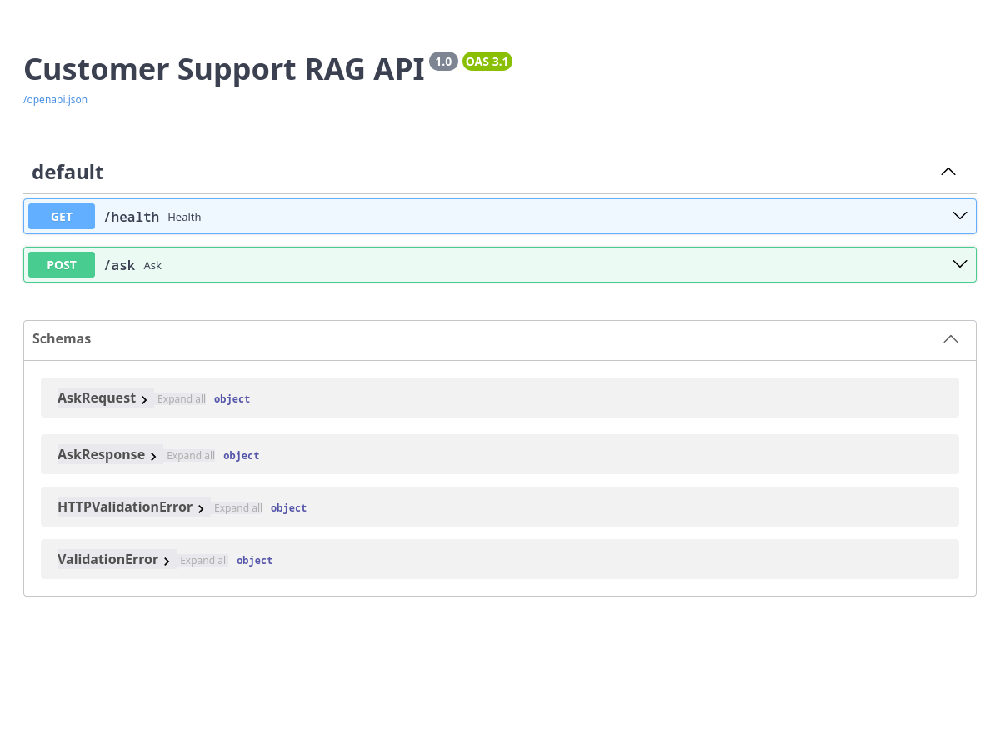
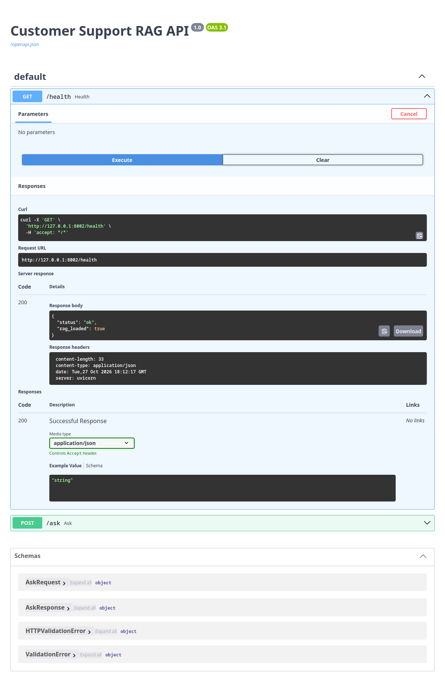
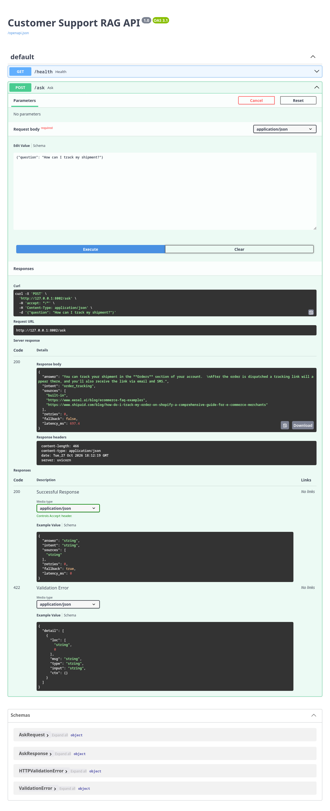
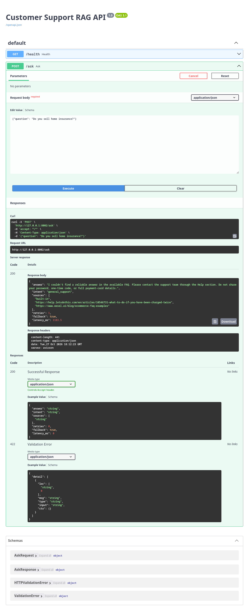
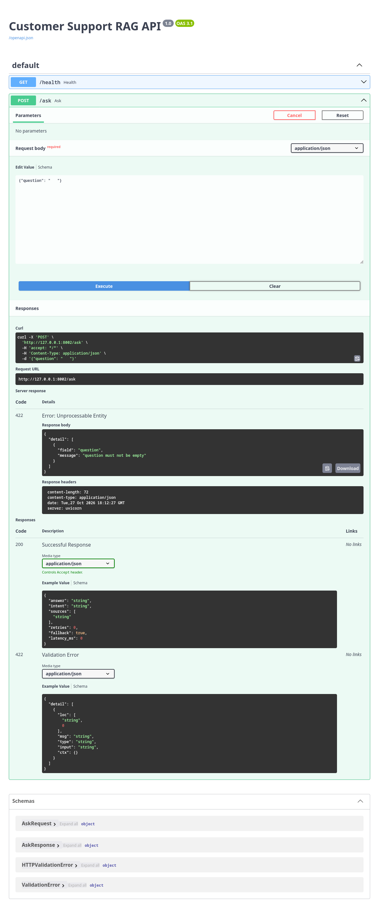
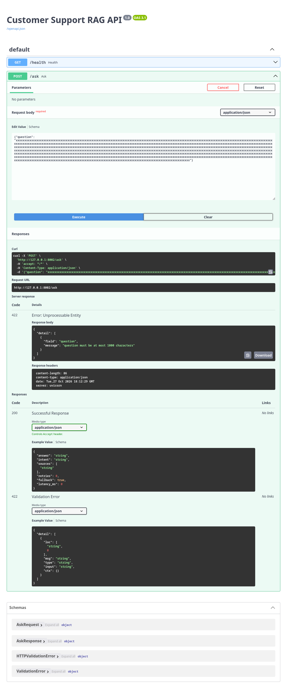
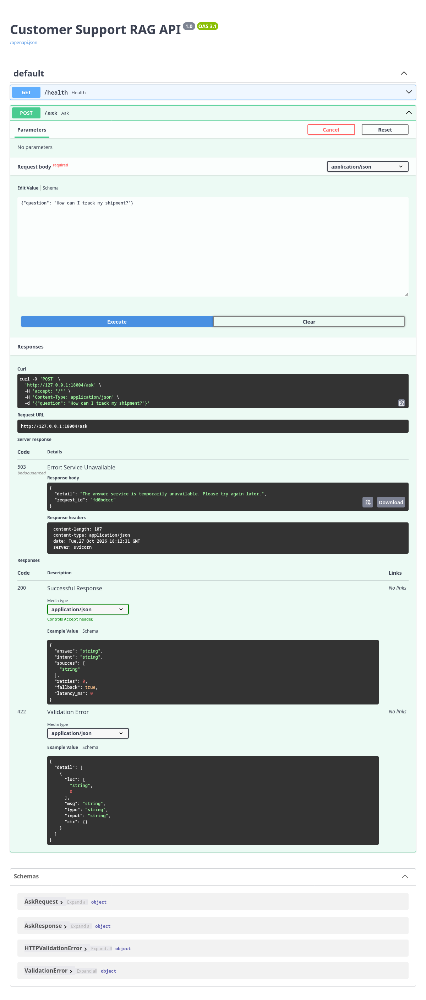
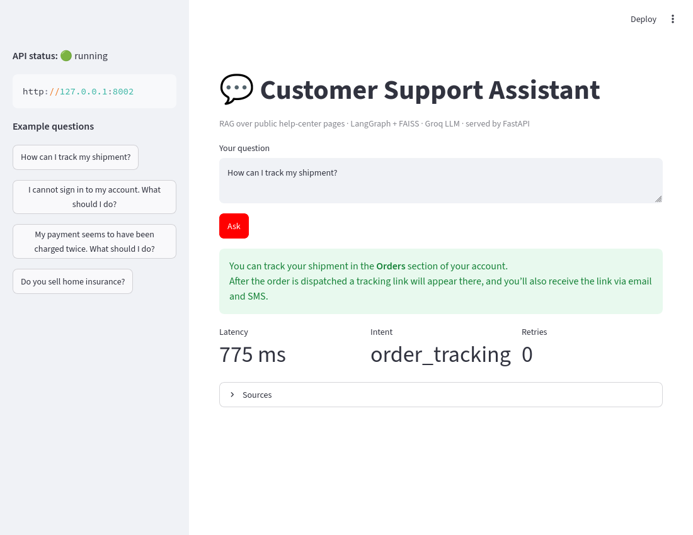
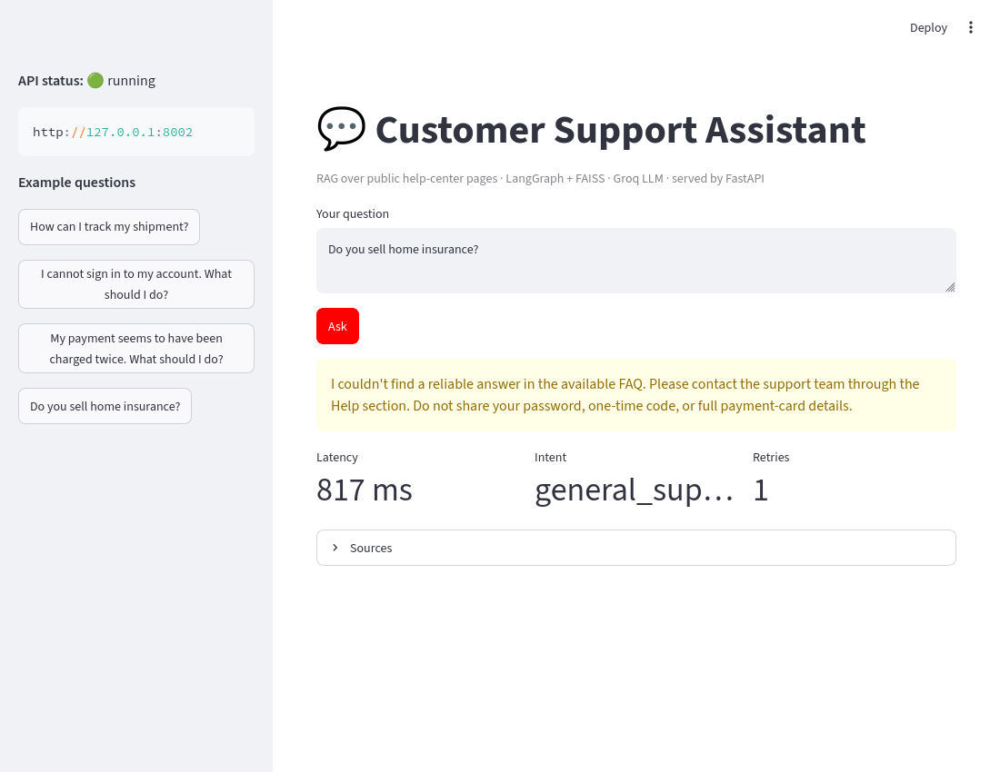

# Experiment 7 — Preparing an LLM Application for Production-Ready Deployment

The Customer Support RAG application from Experiment 6 (LangChain + LangGraph + FAISS) exposed as a
**FastAPI** service, with a **Streamlit** frontend.

**Selected backend:** ☑ Cloud-hosted API (**Groq**, model `openai/gpt-oss-20b`)  ☐ Ollama local LLM

## Structure
```
app.py             FastAPI: POST /ask, GET /health, validation, error handling, logging, latency
support_rag.py     RAG pipeline (loading, chunking, MiniLM embeddings, FAISS, LangGraph) + Groq/mock backend
build_kb.py        Downloads the public help-center pages into support_faq.txt
support_faq.txt    Knowledge base
streamlit_app.py   Frontend
test_api.py        Offline endpoint tests (mock backend)
.env.example       Config template (real .env is git-ignored)
```
The retriever/graph is separate from the LLM backend: `support_rag.generate()` dispatches to `groq_generate` or
`mock_generate`, so the model can be swapped without touching retrieval. The embedding model, FAISS index and
LangGraph are built **once at startup** (FastAPI lifespan), not per request.

## Run
```bash
python -m venv .venv && source .venv/bin/activate
pip install -r requirements.txt
cp .env.example .env          # then put your Groq key in .env
uvicorn app:app --port 8000   # docs at http://127.0.0.1:8000/docs
streamlit run streamlit_app.py   # (API_URL=http://127.0.0.1:8000 by default)
pytest -q test_api.py            # offline tests, no key needed
```

## Production-oriented features
- **Validation:** empty/whitespace question and > 1000 characters → `422` with a short message (input is not echoed back).
- **Error handling:** provider/network failures → generic `503`; unexpected errors → generic `500`. No stack traces, keys
  or provider response bodies are returned; only a `request_id` to correlate with the server log.
- **Logging:** `req=<id> status=success|failure intent=… fallback=… question_chars=… latency_ms=…` — the question text
  and the API key are never logged.
- **Latency:** measured with `perf_counter`, returned as `latency_ms` and logged.
- **Secrets:** key lives in `.env` (git-ignored); `.env.example` is committed.
- **Unsupported questions:** the LLM is told to output `INSUFFICIENT_CONTEXT`; after one retry with an expanded query
  the graph returns a fixed fallback message instead of inventing a policy.

Sample server log:
```
23:38:59,924 INFO api req=b64d3a2b status=success intent=order_tracking fallback=False question_chars=28 latency_ms=920
23:39:01,985 INFO api req=c8a5c874 status=success intent=general_support fallback=True question_chars=27 latency_ms=2035
23:39:03,188 INFO api req=1fe49709 status=success intent=general_support fallback=True question_chars=41 latency_ms=1169
23:42:21,042 INFO api req=877fac85 status=success intent=order_tracking fallback=False question_chars=28 latency_ms=697
```

## Screenshots
| | |
|---|---|
| **Swagger UI**  | **GET /health**  |
| **Supported question**  | **Unsupported question → fallback**  |
| **Empty question → 422**  | **Too-long question → 422**  |
| **Backend failure (invalid key) → 503**  | |
| **Streamlit – supported**  | **Streamlit – unsupported**  |

## Observation table
| Test case | Expected result | Actual result | Pass/Fail |
|---|---|---|---|
| Health endpoint | API reports running | `200 {"status":"ok","rag_loaded":true}` | Pass |
| Supported question ("How can I track my shipment?") | Grounded answer | Answer from the Orders-section/tracking-link passages, sources listed, ~0.7–0.9 s | Pass |
| Unsupported question ("Do you sell home insurance?") | Insufficient information / fallback | 1 retry, then the fixed fallback message (`fallback: true`) | Pass |
| Empty question | Validation error | `422 "question must not be empty"` | Pass |
| Question > 1000 chars | Validation error | `422 "question must be at most 1000 characters"` | Pass |
| Backend unavailable (invalid key) | Controlled error; no secret details | `503` generic message + `request_id`; log shows only `provider returned HTTP 401` | Pass |
| Response-time measurement | Latency recorded | `latency_ms` in response and in log | Pass |

Note: Groq's earlier default `llama-3.1-8b-instant` returned HTTP 404 (model retired); the available models were
checked with the `/models` endpoint and `openai/gpt-oss-20b` was used. This is exactly the "check the model name"
failure the manual describes, and it surfaced as a controlled `503`.

## Viva answers
1. **Purpose of FastAPI:** exposes the RAG pipeline as HTTP endpoints so other apps can send a question and get an answer, with automatic validation and interactive docs.
2. **Local vs cloud LLM:** a local LLM (Ollama) runs on your own machine using its RAM/disk; a cloud API runs on the provider's servers and is called over the internet, with keys, quotas and network dependence.
3. **Does hosting FastAPI in the cloud host the LLM?** No. The API can be in the cloud while the model still runs elsewhere (a provider API or a separate server).
4. **Why no hard-coded API key?** Source code gets committed/shared, so the key leaks; env vars/`.env` keep secrets out of version control and allow rotation per environment.
5. **Input validation / max length:** checking that input is well-formed before processing. A length cap prevents abuse, high token cost, slow requests and oversized prompts.
6. **Health endpoint:** tells monitors/load balancers the process is alive. Limitation: it does not prove the LLM provider, quota or network works.
7. **Why not reload model/index per request:** loading is slow and memory-heavy (~15 s here vs <1 s per request); load once and reuse.
8. **Answer absent from the knowledge base:** say there is not enough information and point to support, rather than hallucinate.
9. **Two cloud failure reasons:** invalid/expired key or exhausted quota/rate limit (401/429); network outage/timeout or wrong/retired model name (404).
10. **Fully production-ready?** No. Needs e.g. authentication, HTTPS, rate limiting, monitoring, secure secret management, load testing, model evaluation, recovery plan.

## Limitations
Rule-based intent classifier; the review step only checks the `INSUFFICIENT_CONTEXT` marker (not a factuality verifier); knowledge base is public third-party help pages used as sample FAQ content. Do not send confidential or personal data to the third-party API.
